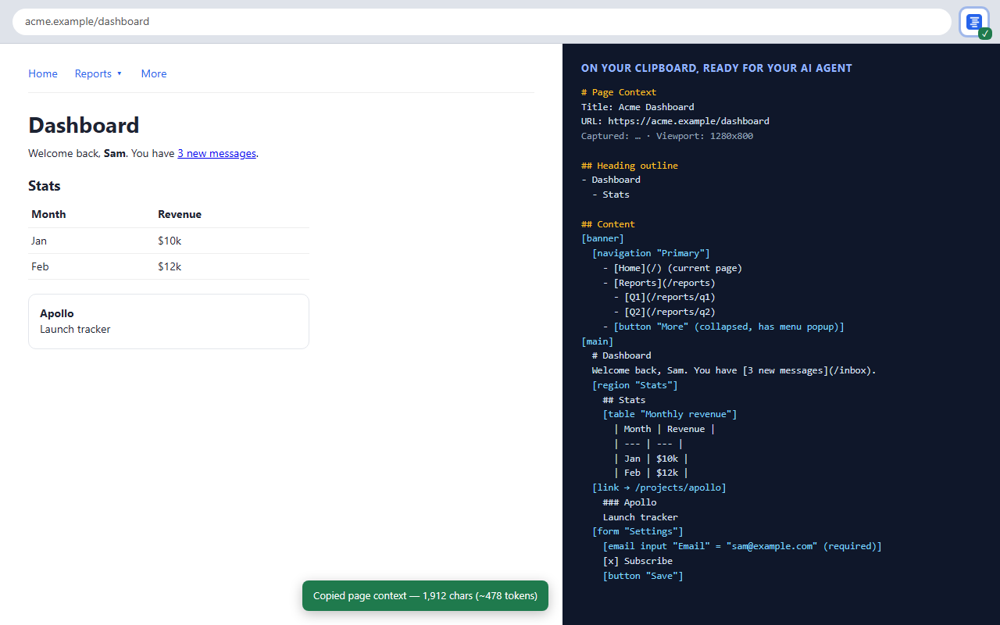

# Page Context Copier

A Chrome extension (Manifest V3) that copies a web page to the clipboard as a structured outline you can paste into an AI agent. The outline keeps the page's nesting (landmarks, lists, tables, forms) and its accessibility info (roles, labels, states, alt text), plus the page's metadata. It leaves out raw HTML.



## Install

1. Open `chrome://extensions` and turn on **Developer mode**.
2. Click **Load unpacked** and choose this folder (the one with `manifest.json`).
3. Pin the extension from the puzzle-piece menu.

## Use

| To copy | Do this |
| --- | --- |
| The whole page | Click the toolbar button, press **Alt+Shift+C**, or right-click → **Copy page context for AI** |
| Just the part around a selection | Select text, right-click → **Copy context of selection for AI** |

A toast on the page shows how much was copied (characters, and tokens estimated at 4 characters each). The toolbar badge flashes ✓ on success or `!` on failure. Failures usually mean the page is one Chrome won't let extensions script, such as `chrome://` pages, the Web Store, or the PDF viewer. Hover the button to see the error.

You can change the shortcut at `chrome://extensions/shortcuts`.

## What you get

```
# Page Context
Title: Acme Dashboard
URL: https://acme.example/dashboard
Language: en
Captured: …
Viewport: 1280x800, scrolled to 0 of 1142px

## Metadata
- og:title: Acme Dashboard

## Heading outline
- Dashboard
  - Stats

## Content
[main]
  # Dashboard
  Welcome back, Sam. You have [3 new messages](/inbox).
  [region "Stats"]
    [table "Monthly revenue"]
      | Month | Revenue |
      | --- | --- |
      | Jan | $10k |
  [form "Settings"]
    [email input "Email" = "sam@example.com" (required)]
    [password input "Password" = (filled, value hidden)]
    [combobox "Theme" = "Dark"] options: Light | Dark
```

The header can also include the meta description, the focused element and any selected text. Pages with JSON-LD get a **Structured data** section. In selection mode, the selected text comes first and the outline covers only the smallest element that contains the selection.

The outline follows these rules:

- **Only meaningful structure is indented.** Generic `div`s and `span`s add nothing. Landmarks, lists, tables, labelled groups, ARIA widgets, dialogs and same-origin iframes each get a level.
- **Inline content stays inline.** Links become `[text](url)`, images `` and code `` `code` ``.
- **Hidden content is skipped**, except screen-reader-only text, which often explains what an icon means.
- **Open shadow roots and slots are followed**, so pages built from web components come through.
- **Sensitive values are masked.** Password, credit-card and one-time-code fields show `(filled, value hidden)`. Hidden inputs, decorative images and small unlabeled icons are dropped.

## Privacy

The extension reads a tab only when you trigger it, and it has no host permissions. It makes no network requests and stores nothing. It uses five permissions:

- `activeTab` and `scripting` to read the current tab
- `clipboardWrite` and `offscreen` to copy
- `contextMenus` for the right-click items

See [`PRIVACY.md`](PRIVACY.md).

## Code

| File | Role |
| --- | --- |
| `src/background.js` | Service worker. Handles the button, shortcut and menu, injects the extractor, and sets the badge |
| `src/extract.js` | Runs in the page. Walks the DOM, builds the outline and shows the toast |
| `src/offscreen.html`, `src/offscreen.js` | Writes to the clipboard, because MV3 service workers have no DOM |

## Development

`test/fixture.html` exercises most cases and loads `src/extract.js` directly, so you can test without the extension. Serve the repo:

```bash
python -m http.server 8765
```

Then open `http://localhost:8765/test/fixture.html` and run `__pageContextCopier.extract('page')` in DevTools. The `fixture` config in `.claude/launch.json` starts the same server.

After editing, reload the extension from its card in `chrome://extensions`.

## Publishing

```bash
python scripts/package.py              # dist/page-context-copier-<version>.zip (manifest, src, icons)
python scripts/render_store_images.py  # store/*.png from store/*.html, using headless Chrome
```

Bump `version` in `manifest.json` before packaging. The listing copy, permission justifications and data-use answers are in [`store/LISTING.md`](store/LISTING.md).

## License

MIT
